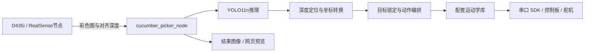

# 黄瓜采摘机器人

基于 YOLO11n、RealSense RGB-D 相机与 ROS2 的采摘原型，在实验室环境中验证黄瓜检测、三维定位、坐标转换与机械臂抓取流程。

## 系统组成

树莓派运行 ROS2 Humble 和 ONNX Runtime；D435i 提供彩色图与对齐深度；控制板通过串口接收舵机指令。当前程序控制 1–5 号机械臂关节，10 号舵机用于夹爪。正逆运动学使用机械臂配套库。



检测、定位和抓取是主节点内部模块。默认输入话题为 `/camera/camera/color/image_raw` 和 `/camera/camera/aligned_depth_to_color/image_raw`，结果图像发布到 `/cucumber_picker/image_result`，消息类型均为 `sensor_msgs/msg/Image`。

## 文件结构

| 路径 | 内容 |
| --- | --- |
| `main_picker.py` | 检测、定位、锁定、抓取和预览 |
| `fixed_xyz_test.py` | 固定点逆运动学与运动调试 |
| `camera_test.py` | RealSense SDK 相机检查 |
| `servo_smoke_test.py` | 单舵机运动检查 |
| `servo_controller.py` | 舵机控制入口 |
| `bus_servo_control.py` | 总线舵机指令封装 |
| `ros_robot_controller_sdk.py` | 控制板串口协议 SDK |
| `action_group_controller.py` | 配套动作组读取 |
| `kinematics/` | 配套运动学库与转换工具 |
| `models/` | ONNX 推理模型 |
| `docs/` | 部署、实现、训练结果及来源说明 |

## 启动

需要设备兼容的 Linux/Python、ROS2 Humble、`cv_bridge`、`realsense2_camera` 及 `requirements.txt` 中的依赖。配套 `.so` 文件与处理器架构、Python ABI 有关，不能直接在 Windows 上运行。

先在独立终端启动相机：

```bash
source /opt/ros/humble/setup.bash
ros2 launch realsense2_camera rs_launch.py align_depth.enable:=true depth_module.profile:=640x480x30 rgb_camera.profile:=640x480x30
```

另开终端进入项目目录，观察识别和定位：

```bash
source /opt/ros/humble/setup.bash
export RRC_DEVICE=/dev/rrc
python3 main_picker.py --skip-init
```

浏览器打开 `http://<树莓派IP>:8080/`。程序默认不执行采摘，但未指定 `--skip-init` 时仍会初始归位和打开夹爪。控制模块导入时会打开串口，所以仅观察也需要控制板连接。

详细步骤见 [运行说明](docs/运行说明.md)。

## 检测结果与边界

现有训练记录采用 YOLO11n，输入 640×640，batch 16，共 200 轮。第 175 轮验证记录：Precision 96.75%、Recall 90.79%、mAP50 97.75%、mAP50-95 75.37%。

当前坐标转换依赖固定轴向映射、安装偏置和配套正运动学。动作采用预设姿态与分段执行。实现细节见 [实现说明](docs/实现说明.md)。

