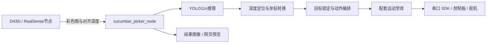

# 黄瓜采摘机器人

本项目是一套运行在树莓派与 ROS2 环境下的黄瓜采摘机器人视觉定位与控制系统。系统通过 D435i 深度相机采集彩色图像和对齐深度图，利用 YOLO11n 识别黄瓜目标，结合深度信息计算目标位置，再通过坐标转换与逆运动学解算，驱动机械臂完成靠近、夹取、旋转摘取、释放和复位。项目已在实验室完成实物抓取流程验证。

## 系统组成

系统由树莓派、Intel RealSense D435i、STM32F4 控制板和总线舵机机械臂组成。树莓派负责图像处理、目标定位和动作控制，STM32F4 控制板接收串口指令并驱动舵机执行动作。



RealSense 相机节点提供图像数据，采摘主程序统一完成检测、定位、目标锁定与执行控制，并通过 ROS2 结果图像和网页预览显示运行状态。

## 主要功能

- **目标检测**：加载训练后的 YOLO11n ONNX 模型，输出黄瓜检测框和置信度；采用间隔推理降低嵌入式平台的计算负担。
- **三维定位**：读取检测框中心邻域的有效深度，结合相机内参计算目标在相机坐标系下的三维位置。
- **坐标转换**：根据相机安装关系和机械臂末端位姿，将目标点转换到机械臂基座坐标系。
- **目标锁定**：汇集连续多帧目标坐标，取中位数确定抓取位置，供后续动作执行使用。
- **采摘控制**：根据目标位置和设定姿态进行逆运动学求解，选择关节变化较小的候选方案，执行靠近、夹取、旋转、释放和复位。
- **预览与调试**：显示检测框、锁定框及目标坐标，支持固定坐标测试、分组运动和逐关节调试。

## 文件结构

| 路径 | 内容 |
| --- | --- |
| `main_picker.py` | 检测、定位、锁定、抓取和预览 |
| `fixed_xyz_test.py` | 固定点逆运动学与运动调试 |
| `camera_test.py` | RealSense SDK 相机检查 |
| `servo_smoke_test.py` | 单舵机运动检查 |
| `servo_controller.py` | 舵机控制入口 |
| `bus_servo_control.py` | 总线舵机指令封装 |
| `ros_robot_controller_sdk.py` | 控制板串口协议 SDK |
| `action_group_controller.py` | 配套动作组读取 |
| `kinematics/` | 配套运动学库与转换工具 |
| `models/` | ONNX 推理模型 |
| `docs/` | 部署、实现、训练结果及来源说明 |

## 启动

运行环境为 Linux、Python 3 和 ROS2 Humble，依赖 `cv_bridge`、`realsense2_camera` 及 `requirements.txt` 中的 Python 库。运动学扩展需与部署设备的处理器架构和 Python 版本匹配。

先在独立终端启动相机：

```bash
source /opt/ros/humble/setup.bash
ros2 launch realsense2_camera rs_launch.py align_depth.enable:=true depth_module.profile:=640x480x30 rgb_camera.profile:=640x480x30
```

另开终端进入项目目录，观察识别和定位：

```bash
source /opt/ros/humble/setup.bash
export RRC_DEVICE=/dev/rrc
python3 main_picker.py --skip-init
```

浏览器打开 `http://<树莓派IP>:8080/` 查看识别结果与坐标。以上命令用于观察模式，启动前需连接相机和控制板。正常启动时程序会归位并打开夹爪，`--skip-init` 用于跳过归位，`--enable-pick` 用于开启采摘动作。

详细步骤见 [运行说明](docs/运行说明.md)。

## 检测结果

模型采用 YOLO11n，输入尺寸为 640×640，batch size 为 16，共训练 200 轮。第 175 轮的验证集结果如下：

| Precision | Recall | mAP50 | mAP50-95 |
| --- | --- | --- | --- |
| 96.75% | 90.79% | 97.75% | 75.37% |

训练配置与曲线见 [训练结果](docs/训练结果.md)，各模块的处理过程见 [实现说明](docs/实现说明.md)。设备配套 SDK 和运动学库的来源见 [第三方说明](docs/第三方说明.md)。

