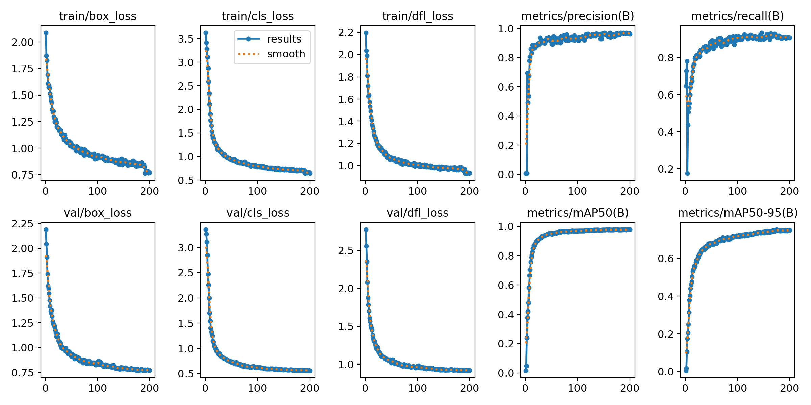
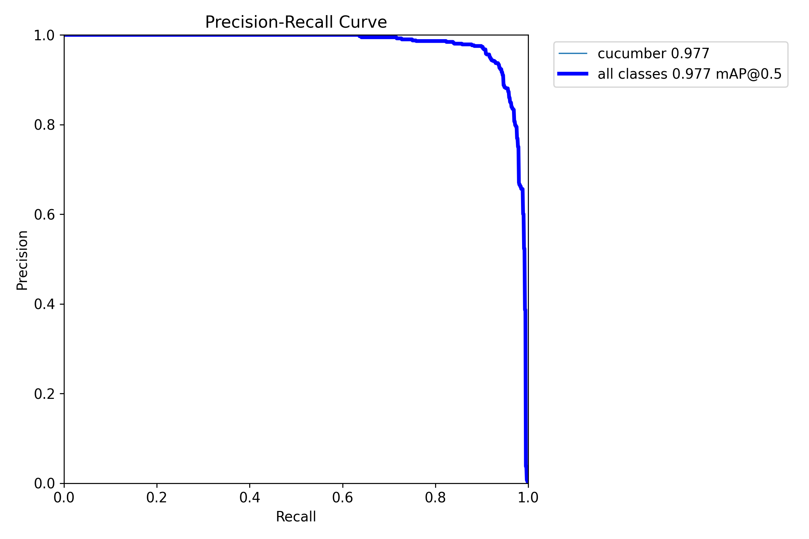

# 训练结果

本次训练记录保存在 `cucumber_innov_b16_lr0.00037`，具体参数见 [args.yaml](training/args.yaml)，逐轮结果见 [results.csv](training/results.csv)。初始学习率按保存的配置为 0.0003。

| 配置 | 值 |
| --- | --- |
| 初始模型 | yolo11n.pt |
| 输入尺寸 | 640×640 |
| epochs / batch | 200 / 16 |
| 优化器 | SGD |
| 初始学习率 | 0.0003 |
| 预训练 | 开启 |

| 验证记录 | Precision | Recall | mAP50 | mAP50-95 |
| --- | --- | --- | --- | --- |
| 第 175 轮 | 96.752% | 90.793% | 97.746% | 75.366% |
| 第 200 轮 | 96.163% | 90.701% | 97.831% | 75.021% |

第 175 轮的 mAP50-95 达到本次训练最高值 75.366%。

检测训练配置采用 HSV 扰动、平移、缩放、水平翻转、Mosaic 和 MixUp，分别用于增加颜色、位置、尺度和画面组合的变化。

训练曲线显示，训练与验证损失逐步下降，检测指标在后期趋于稳定。mAP50 用于评价 IoU 阈值为 0.5 时的检测表现；mAP50-95 对多个 IoU 阈值取平均，对检测框的位置与大小要求更严格。
